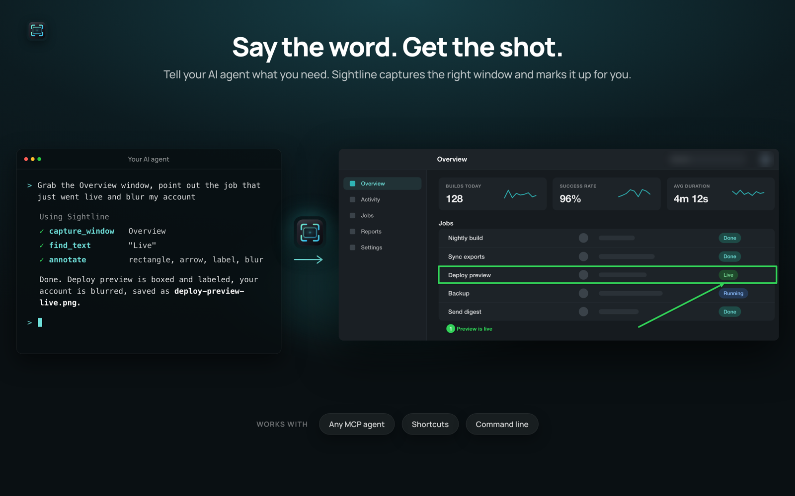
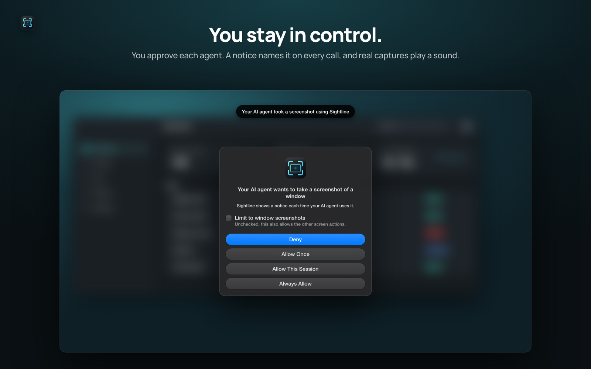

# Sightline MCP server and Claude Code plugin

Sightline's MCP server lets Claude Code, Claude Desktop, Codex CLI and other MCP clients capture, read, mark up, record and compare the Mac screen. The server ships inside [Sightline](https://sightlinemac.com/), the screenshot and recording app for Mac. It runs locally over stdio and nothing leaves your Mac.

This repository is a Claude Code plugin and plugin marketplace. It starts the server from the installed app and adds three skills. It does not contain the server itself.



## Before you install

1. Install [Sightline from the Mac App Store](https://apps.apple.com/app/id6812521593) (macOS 14 or later; recording needs macOS 15).
2. Give Sightline Screen Recording permission in System Settings > Privacy & Security > Screen & System Audio Recording.
3. In Sightline, open Settings > AI Agents and turn on Allow AI agents to use Sightline. It is off until you turn it on.
4. Start the 7 day Pro trial or subscribe. Agent access is part of Sightline Pro; without it every call returns "Sightline Pro is required for agent access".

Sightline should be running. If it isn't, the server starts it in the background.

## Claude Code plugin

```bash
claude plugin install sightline --marketplace PhilJay/sightline-mcp
```

Or in two steps:

```bash
claude plugin marketplace add PhilJay/sightline-mcp
claude plugin install sightline@sightlinemac
```

Inside a session: `/plugin install sightline --marketplace PhilJay/sightline-mcp`.

The plugin loads the Sightline MCP server and three skills:

- `/sightline:compare-ui-with-design` compares a running app or the iOS Simulator with a design image, fixes the differences and checks again until none remain.
- `/sightline:capture-and-inspect` captures a window, area or display and reads text, codes or colors.
- `/sightline:markup-open-capture` marks up the screenshot you have open in Sightline.

Start a new session (or run `/reload-plugins`), check that `/mcp` lists `plugin:sightline:sightline`, and approve the agent when Sightline asks the first time.

If you already connected Sightline with Settings > AI Agents > Connect or `claude mcp add`, Claude Code keeps that server and skips the plugin's copy, so `/mcp` shows `sightline` instead. The skills work either way. To use only the plugin, run `claude mcp remove sightline --scope user`.

## Codex CLI

Codex doesn't install Claude Code plugins. Add this to `~/.codex/config.toml`, replacing an older `[mcp_servers.sightline]` block if there is one, then start a new Codex session:

```toml
[mcp_servers.sightline]
command = "/Applications/Sightline.app/Contents/MacOS/sightline-cli"
args = ["mcp"]
```

This is the same block that Sightline's Settings > AI Agents > Connect writes.

## Other ways to connect

- In Sightline, Settings > AI Agents > Connect sets it up for Claude Code, Claude Desktop or Codex CLI.
- Claude Code without the plugin (writes `~/.claude.json`):

  ```bash
  claude mcp add --scope user sightline -- "/Applications/Sightline.app/Contents/MacOS/sightline-cli" mcp
  ```

- Any other MCP client: run `/Applications/Sightline.app/Contents/MacOS/sightline-cli mcp` as a stdio server.

## You stay in control



- Agent access is off until you turn it on in Settings > AI Agents.
- A new agent has to ask for permission first. Allowed agents are listed in Settings and can be removed at any time.
- Every agent capture plays the capture sound and names the agent.
- Agents can't change settings. They read and write only inside your screenshot folder and the Agent folder.
- There is no Sightline server. Screen data stays on your Mac. The app may contact the App Store through StoreKit for purchases.

## Command line

The same tools work from the terminal and in scripts. Sightline has to be running with agent access on, and it asks you to allow `sightline-cli` the first time.

```bash
/Applications/Sightline.app/Contents/MacOS/sightline-cli tools
/Applications/Sightline.app/Contents/MacOS/sightline-cli capture_window --json '{"app": "Safari"}'
```

## Tools

The Mac App Store version lists 24 tools. A version outside the App Store lists 25, adding `capture_scrolling`, which the sandbox can't offer because it can't scroll other apps.

- Capture: `capture_screen`, `capture_area`, `capture_window`, `capture_scrolling`, `list_windows`, `list_displays`
- Read: `capture_text` (OCR, QR codes and barcodes), `find_text`, `pick_color`
- Mark up and style: `annotate`, `beautify`, `list_looks`, `save_look`, `remove_background` (macOS 27)
- Editors and files: `open_in_editor`, `list_editors`, `export_pictures`, `copy_to_clipboard`, `last_screenshot`, `last_recording`, `search_captures`
- Recordings: `record_screen` (macOS 15), `inspect_recording`, `save_replay` (macOS 27)
- Design check: `compare_with_design`, the same check as Show Differences on a pin

Every tool and its parameters: [sightlinemac.com/docs/mcp](https://sightlinemac.com/docs/mcp/). Command line: [sightlinemac.com/docs/cli](https://sightlinemac.com/docs/cli/).

## What this plugin runs

The plugin starts the local binary `/Applications/Sightline.app/Contents/MacOS/sightline-cli` with the argument `mcp`. That process talks only to the running Sightline app on the same Mac over a local socket and sends no screen data to any server. It works in Claude Code and in Claude Desktop sessions that run on your Mac, but not on claude.ai in the browser, which can't start a local stdio server.
