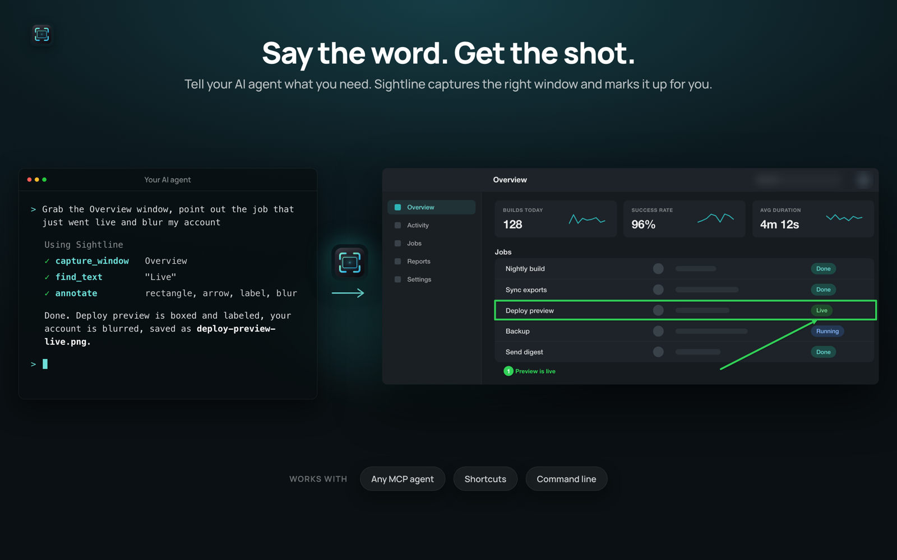
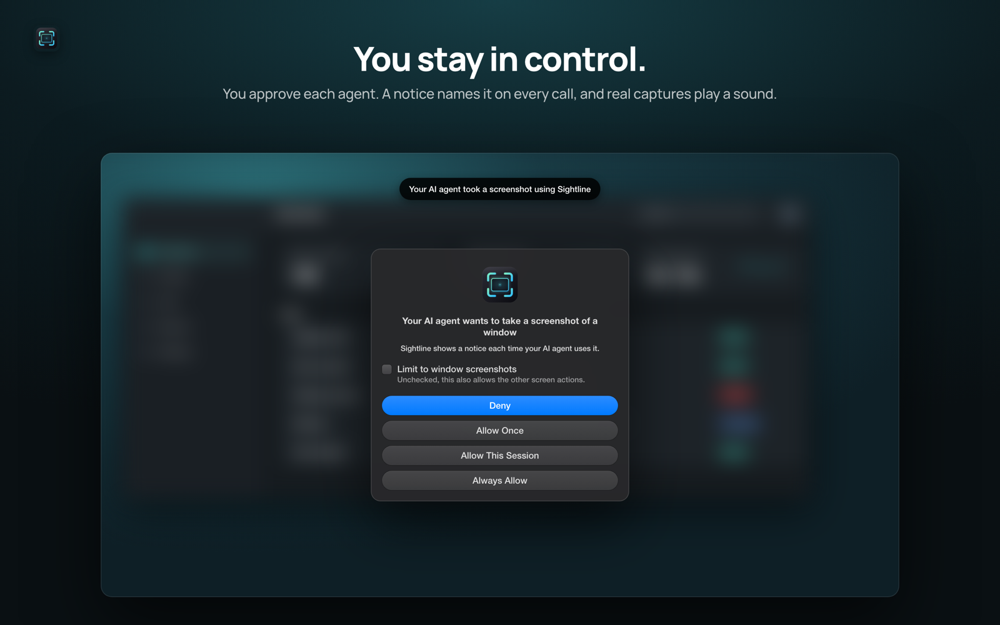

# Sightline MCP server

Screenshots, OCR, scrolling capture, annotations and screen recording on macOS for AI agents like Claude Code, Claude Desktop and Codex CLI.

The server is part of [Sightline](https://apps.apple.com/app/id6812521593), the screenshot and recording app for Mac ([sightlinemac.com](https://sightlinemac.com/)). It runs locally over stdio and nothing leaves your Mac.



## You stay in control



- Agent access is off until you turn it on in Settings > AI Agents.
- A new agent has to ask for permission first. Allowed agents are listed in Settings and can be removed at any time.
- Every agent capture plays the capture sound and names the agent.
- Agents can't change settings and only read and write inside your screenshot folder.

## Setup

1. Install [Sightline](https://apps.apple.com/app/id6812521593) from the Mac App Store (macOS 14 or later) and give it Screen Recording permission.
2. Open Settings > AI Agents, turn agent access on and click Connect for Claude Code, Claude Desktop or Codex CLI.

Or add it by hand. Claude Code:

```
claude mcp add --scope user sightline -- "/Applications/Sightline.app/Contents/MacOS/sightline-cli" mcp
```

Codex CLI, in `~/.codex/config.toml`:

```toml
[mcp_servers.sightline]
command = "/Applications/Sightline.app/Contents/MacOS/sightline-cli"
args = ["mcp"]
```

Any other client: run `/Applications/Sightline.app/Contents/MacOS/sightline-cli mcp` as a stdio server.

## Command line

The same tools work from the terminal and in scripts. Sightline has to be running with agent access on, and it asks you to allow `sightline-cli` the first time.

```
sightline-cli tools                                      # list the tools
sightline-cli capture_window --json '{"app": "Safari"}'  # call one, prints JSON
```

`sightline-cli` lives at `/Applications/Sightline.app/Contents/MacOS/sightline-cli`.

## Tools

- `capture_screen`, `capture_area`, `capture_window` capture a display, an area or a window, optionally with annotations.
- `list_windows` lists the on-screen windows with app name, title and window id.
- `list_displays` lists the connected displays, so a capture, recording or text read can pick one.
- `capture_text` reads text with on-device OCR and decodes QR codes and barcodes.
- `find_text` returns pixel boxes for text in a window, area or display.
- `pick_color` returns the hex and RGB color of one point on screen.
- `capture_scrolling` stitches a scrolling area or window into one tall image.
- `annotate` draws arrows, shapes, freehand lines, text, spotlights and blurs or pixelation onto an image or a video. On a screenshot it also crops, rotates, flips, resizes and exports. On a recording it also cuts and reorders clips, plays them at 0.5x to 15x, sets the volume of stretches, adds smooth or instant zooms by hand or on every click, draws the pointer and click highlights and exports a smaller copy or a looping GIF; blurs follow what they cover.
- `record_screen` records a window, area or display for up to a minute to MP4 and notes where the pointer moves and clicks. It never records the microphone.
- `inspect_recording` reports when a recording is still or moving, reads text in chosen frames and lists the clicks of the pointer track.
- `last_screenshot`, `last_recording` return the newest capture.
- `search_captures` searches the user's screenshots and recordings like Sightline's History, by file name and by the text Sightline read in each screenshot on the Mac, and returns paths, dates, favorites and a snippet of the matching text.
- `copy_to_clipboard` copies an image to the clipboard.
- `compare_with_design` compares a design image with a window, area or display, the same check as Show Differences on a pin, and returns up to 20 numbered differences with a hint (shifted, only_in_design, only_on_screen, looks_different) and a marked image.
- `open_in_editor` opens an image or recording in the Sightline editor with editable annotations, clips, sound, zooms, pointer choices, a rotation, a size or a Beautify look, continues a capture the user saved as editable, or opens the picture on the user's clipboard.
- `beautify` puts a screenshot on a background with padding, rounded corners and a shadow, using a built-in look, one of the user's presets or their default look.
- `list_looks` lists the built-in looks, the user's presets and their default look; `save_look` saves a new preset.
- `save_replay` saves the last seconds of the screen when Replay is on (macOS 27).

### New in Sightline 1.7

Screenshots, on `annotate` and `open_in_editor` unless noted:

- `rotate`: 90, 180 or 270 degrees clockwise. `flip`: `horizontal` or `vertical`, applied after `rotate`. Marks and crop move with the picture.
- `resize`: `{scale}` from 0.05 to 1, `{width}` or `{height}` in pixels (the other side keeps the shape), or `{width, height}` (may stretch). Only shrinks, each side at least 16 pixels.
- `export` (`annotate` only): `{format: png | jpeg | webp, quality: high | medium | small}`, always written to a new file.
- Text annotations, also the text inside a rectangle or ellipse: `font` (`system`, `rounded`, `serif`, `monospaced`, `handwriting`), `bold` (boolean, default true) and `text_background` (`none`, `solid`, `translucent`).

Recordings:

- `zoom_on_clicks: true` adds a 2x zoom for every click or group of clicks in the pointer track.
- Each entry in `zooms` takes `follow`: `off` (default), `pointer` or `content`.
- `pointer`: `{shown, size: 1 | 1.5 | 2, hide_when_idle, click_highlight: off | ripple | ring, highlight_color: "#FFD60A"}`. `shown`, `size` and `hide_when_idle` need a recording made with Pointer set to Editable in the editor in Settings → Recording.
- `export` (`annotate` only): `{size: original | 1080p | 720p, format: mp4 | mov, quality: high | medium | small}`.
- `export` with `format: gif` writes a GIF that loops forever, without sound, with the same cuts, speeds, zooms, marks, blurs and pointer: `{format: gif, preset: chat | docs, width, fps}`. `chat` (default) is 640 pixels wide at 10 frames a second, `docs` 960 pixels at 15; `width` (160 to 1920) and `fps` (1 to 30) replace the preset's values. `size` and `quality` don't apply. A `.gif` result can't be passed to `annotate`, `inspect_recording` or `open_in_editor` again.
- `highlight_color` also takes gray, `#8E8E93`.
- `record_screen` takes `pointer`: `off`, `video` (default) or `drawn`.
- `inspect_recording` returns `has_pointer_track` and the `clicks` of the track.

Captures:

- `search_captures` takes `query` (every word has to appear in the file name or the screenshot's text, in any order, ignoring case and accents; empty lists the newest), `kind` (`screenshot` or `recording`, both by default), `favorites_only` (default false) and `limit` (1 to 100, default 20). Each result has `path`, `kind`, `date`, `favorite` and, when the text matched, a `snippet`; a snippet that looks like a credential is left out when Sightline redacts them for agents. `total` counts every match, and `reading_text` says how many screenshots are still waiting to be read. Recordings match by file name only.

The pointer track options need a recording made with Sightline 1.7 or later.
