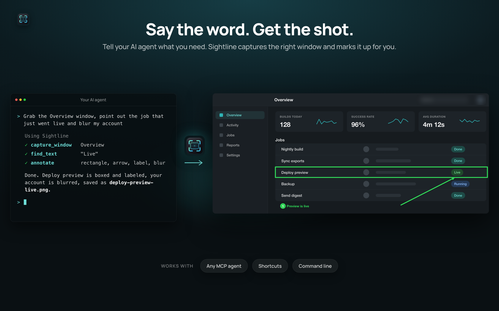
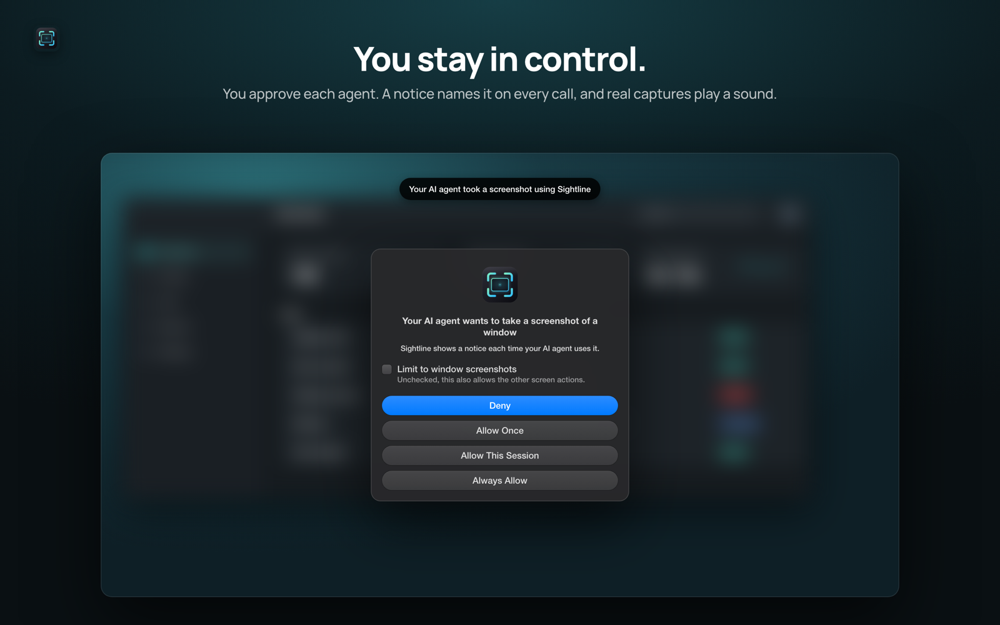

# Sightline MCP server

Screenshots, OCR, scrolling capture, annotations and screen recording on macOS for AI agents like Claude Code, Claude Desktop and Codex CLI.

The server is part of [Sightline](https://apps.apple.com/app/id6812521593), the screenshot and recording app for Mac ([sightlinemac.com](https://sightlinemac.com/)). It runs locally over stdio and nothing leaves your Mac.



## You stay in control



- Agent access is off until you turn it on in Settings > AI Agents.
- A new agent has to ask for permission first. Allowed agents are listed in Settings and can be removed at any time.
- Every agent capture plays the capture sound and names the agent.
- Agents can't change settings and only read and write inside your screenshot folder.

## Setup

Full docs with every tool, its parameters and example workflows: [sightlinemac.com/docs/mcp](https://sightlinemac.com/docs/mcp/).


1. Install [Sightline](https://apps.apple.com/app/id6812521593) from the Mac App Store (macOS 14 or later) and give it Screen Recording permission. Agent access is part of Sightline Pro, with a 7 day free trial.
2. Open Settings > AI Agents, turn agent access on and click Connect for Claude Code, Claude Desktop or Codex CLI.

Or add it by hand. Claude Code:

```
claude mcp add --scope user sightline -- "/Applications/Sightline.app/Contents/MacOS/sightline-cli" mcp
```

Codex CLI, in `~/.codex/config.toml`:

```toml
[mcp_servers.sightline]
command = "/Applications/Sightline.app/Contents/MacOS/sightline-cli"
args = ["mcp"]
```

Any other client: run `/Applications/Sightline.app/Contents/MacOS/sightline-cli mcp` as a stdio server.

## Command line

The same tools work from the terminal and in scripts. Sightline has to be running with agent access on, and it asks you to allow `sightline-cli` the first time.

```
sightline-cli tools                                      # list the tools
sightline-cli capture_window --json '{"app": "Safari"}'  # call one, prints JSON
```

`sightline-cli` lives at `/Applications/Sightline.app/Contents/MacOS/sightline-cli`.

## Tools

Sightline has 25 tools. The Mac App Store version lists 24, without `capture_scrolling`.

- `capture_screen`, `capture_area`, `capture_window` capture a display, an area or a window, optionally with annotations.
- `list_windows` lists the on-screen windows with app name, title and window id.
- `list_displays` lists the connected displays, so a capture, recording or text read can pick one.
- `capture_text` reads text with on-device OCR and decodes QR codes and barcodes.
- `find_text` returns pixel boxes for text in a window, area, display or the screenshot open in an editor.
- `pick_color` returns the hex and RGB color of one point on screen.
- `capture_scrolling` stitches a scrolling area or window into one tall image. The Mac App Store version doesn't list it, because the sandbox can't scroll other apps, and called by name it returns an error; use `capture_window`, or take the scrolling screenshot by hand.
- `annotate` draws arrows, shapes, freehand lines, text, numbers, spotlights, magnify loupes and blurs or pixelation, also by subject (macOS 27), onto an image or a video. On a screenshot it also crops, rotates, flips, resizes, sets a Style look and exports. On a recording it also cuts and reorders clips, plays them at 0.5x to 15x, sets the volume of stretches, adds smooth or instant zooms by hand or on every click, draws the pointer and click highlights, shows the keys pressed while recording, shows, hides, moves, resizes and reshapes the camera the user recorded, and exports a smaller copy, a MOV or a looping GIF; blurs follow what they cover.
- `record_screen` records a window, area or display for up to a minute to MP4, at its original size, 1080p or 720p, and notes where the pointer moves and clicks. It never records the microphone, the camera or the keys pressed, so an agent never captures anyone's voice or face.
- `inspect_recording` reports when a recording is still or moving, reads text in chosen frames and lists the clicks of the pointer track, the keys pressed and the camera parts.
- `last_screenshot`, `last_recording` return the newest capture.
- `list_editors` lists the editors the user has open, front window first, one entry per picture in a window with several, with an image of the front screenshot, so an agent can work on what the user is looking at.
- `search_captures` searches the user's screenshots and recordings like Sightline's History, by file name and by the text Sightline read in each screenshot on the Mac, and returns paths, dates, favorites and a snippet of the matching text.
- `copy_to_clipboard` copies an image or recording to the clipboard, or a picture open in an editor as it looks there, or every picture of that window.
- `compare_with_design` compares a design image with a window, area or display, the same check as Show Differences on a pin, and returns up to 20 numbered differences with a hint (shifted, only_in_design, only_on_screen, looks_different) and a marked image.
- `open_in_editor` opens an image or recording in the Sightline editor with editable annotations, clips, sound, zooms, pointer choices, the camera, a rotation, a size, a Style look or the keys shown, in edit or view mode, opens several screenshots in one window or adds them to an open one, shrinks every picture of a window, continues a capture the user saved as editable, or opens the picture on the user's clipboard.
- `beautify` puts a screenshot on a background with padding, rounded corners and a shadow, like the editor's Style panel, using a built-in look, one of the user's presets or their default look, on one picture or every picture of an editor window.
- `list_looks` lists the built-in looks (None, Soft, Sunset, Night, Paper, Sightline), the user's presets and their default look; `save_look` saves a new preset.
- `export_pictures` writes every picture of an editor window as files into a new folder in the Agent folder, like Export All.
- `remove_background` lifts the subject of a screenshot off its background and saves a transparent PNG (Pro, macOS 27).
- `save_replay` saves the last seconds of the screen when Replay is on (macOS 27).

### New in Sightline 2.0

Camera:

- `annotate` and `open_in_editor` take `camera`: `{parts: [{start_second, end_second, hidden, x, y, height, shape: circle | rounded_rectangle}], shadow}`, like the Camera row and the Camera button in the recording editor. `x` and `y` are the camera's center and `height` its size (0.2 is usual), as shares from 0 to 1 of the finished frame. Seconds count in the original recording, parts must not overlap, and fields a part leaves out keep the camera as it is at its start. `shadow` is on by default. The camera is drawn into every file written, also MP4, MOV and GIF exports.
- `camera` needs a recording the user made with the camera on. Agents can't record the camera themselves, and a stretch the user hid while recording has no picture.
- `inspect_recording` returns `has_camera` and, with a camera, `camera`: `parts` in the form of the `camera` argument, `shadow` and `hidden_while_recording`. `open_in_editor` returns the restored camera of a saved edit in the same form.

Windows with several pictures:

- `export_pictures` takes `editor` (any picture's id from `list_editors`, or `front`), `format` (`png`, `jpeg` or `webp`) and `quality` (`high`, `medium` or `small`), and writes each picture as it looks in the editor, with marks, crop, Style look and size. It returns `folder` and `paths` in column order, and `failed` for pictures that couldn't be written.
- `copy_to_clipboard` takes `editor` to copy a screenshot open in the editor as it looks there now, like Copy, and with `all_pictures: true` every picture of its window, like Copy All.
- `beautify` with `editor` and `all_pictures: true` gives every picture of the window the same look, like Apply Style to All Pictures, each as its own undo step.
- `open_in_editor` with `editor` and `paths` adds one or more screenshots to that window. With `editor`, `all_pictures: true` and `resize` (`scale` or `width` only) it shrinks every picture of the window, like Adjust Size of All Pictures.
- `list_editors` names the window ids to pass: any picture's id works for the whole window.

Remove background:

- `remove_background` takes `path` (or the agent's last screenshot), `name` and `include_image`, and returns the cutout like a capture tool. It works best on a clear subject such as a person, an object, an icon or a window, and returns an error when it finds none. The source stays as it is. Needs Sightline Pro and macOS 27.

### New in Sightline 1.9

- `open_in_editor` takes `paths` to open two or more screenshots together in one editor window, and returns the `editors` id of each. Each picture is its own editor for `annotate`, `beautify` and `open_in_editor`.
- `open_in_editor` takes `mode`: `edit` (default) or `view`, which shows only the picture or video with play controls.
- `list_editors` returns one entry per picture with `window`, `shown`, `unsaved` and `editing` (false in view mode).
- `pointer` takes `smooth` (on by default), which draws a drawn pointer along a smoothed path through every click.

### New in Sightline 1.8

Editors:

- `list_editors` returns each open editor with `id`, `kind` (`screenshot` or `recording`), `title`, `width`, `height`, `path` (or null when the editor shows no file) and `front`, plus an image of the front screenshot editor unless `include_image` is false.
- `annotate`, `open_in_editor` and `beautify` take `editor`, an id from `list_editors` or `front`, instead of a path. The change appears live and animated in that window as one undo step, with the agent's name, and no file is written; the user saves as usual. Coordinates are pixels of the width and height `list_editors` reports. `find_text` takes `editor` too and returns boxes in those pixels.
- When a file an agent changes is open in an editor, also one the user opened, the change lands there live as one undo step.
- `last_screenshot` returns the agent's own last capture; for the user's screenshot call `list_editors`.

Recordings:

- `record_screen` takes `size` (`original`, `1080p` or `720p`) and `quality` (`high`, `medium` or `small`). Anything other than the defaults encodes the recording once more and keeps only the smaller file, with the pointer track scaled to fit.
- `annotate` and `open_in_editor` take `keys`: `{parts: [{start_second, end_second, mode: words | letters | shortcuts | hidden}], position: bottomLeft | bottomCenter | bottomRight | topCenter, size: small | medium | large, look: dark | light}`, like the Keys row and the Keys button in the recording editor. Seconds count in the original recording.
- `inspect_recording` returns `has_key_track` and, with a track, `keys`: each shortcut by its label, such as `⇧⌘5`, and typed text grouped into words, each with `second` and `keys`. At most 200 are listed, `keys_left_out` counts the rest. Keys are noted only for recordings the user makes with Show keystrokes on in Settings > Recording, never for `record_screen` or replays.

Style:

- Beautify is called Style in the app. The tool keeps the name `beautify`, and its looks are None, Soft, Sunset, Night, Paper and Sightline. `ocean` stays available as a `background` gradient.

### New in Sightline 1.7

Screenshots, on `annotate` and `open_in_editor` unless noted:

- `rotate`: 90, 180 or 270 degrees clockwise. `flip`: `horizontal` or `vertical`, applied after `rotate`. Marks and crop move with the picture.
- `resize`: `{scale}` from 0.05 to 1, `{width}` or `{height}` in pixels (the other side keeps the shape), or `{width, height}` (may stretch). Only shrinks, each side at least 16 pixels.
- `export` (`annotate` only): `{format: png | jpeg | webp, quality: high | medium | small}`, always written to a new file.
- Text annotations, also the text inside a rectangle or ellipse: `font` (`system`, `rounded`, `serif`, `monospaced`, `handwriting`, default `system`), `bold` (boolean, default true), `text_background` (`none`, `solid`, `translucent`, default `none`) and `text_background_color` (hex such as `#FFFFFF`; defaults to white or black, whichever stands out from the text, and on its own draws a solid box).

Recordings:

- `zoom_on_clicks: true` adds a 2x zoom for every left click or group of clicks in the pointer track (clicks less than 1.5 s apart and close together share one zoom), on top of the `zooms` passed or the saved edit's zooms.
- Each entry in `zooms` takes `follow`: `off` (default), `pointer` (pans to keep the pointer in view, needs the pointer track) or `content` (tracks what the area shows at the zoom's start).
- `pointer`: `{shown, size: 1 | 1.5 | 2, hide_when_idle, click_highlight: off | ripple | ring, highlight_color: "#FFD60A"}`. `shown`, `size` and `hide_when_idle` need a recording made with the pointer left out to be drawn later: `record_screen` with `pointer: drawn`, or Pointer set to Editable in the editor in Settings → Recording. Click highlights work for every recording with a pointer track.
- `export` (`annotate` only): `{size: original | 1080p | 720p, format: mp4 | mov, quality: high | medium | small}`.
- `export` with `format: gif` writes a GIF that loops forever, without sound, with the same cuts, speeds, zooms, marks, blurs and pointer: `{format: gif, width, fps}`, with `width` in pixels (160 to 1920, default 640) and `fps` (1 to 30, default 10). A narrower video keeps its width, and the result also reports `frames`. `size` and `quality` don't apply. A `.gif` result can't be passed to `annotate`, `inspect_recording` or `open_in_editor` again.
- `highlight_color` also takes gray, `#8E8E93`.
- `record_screen` takes `pointer`: `off`, `video` (default, or `off` when the user's Pointer recording setting is off) or `drawn`, which leaves the pointer out of the MP4 and has Sightline draw it from the track in the editor and in `annotate`'s result. The result's `pointer` says what was used (`drawn` falls back to `video` when the track can't be noted), and `pointer_note` says when the track couldn't be saved.
- `inspect_recording` returns `has_pointer_track` and, with a track, `clicks`: each press with `second`, `x`, `y` in video pixels, `button` (`left` or `right`), `count` (2 for a double click) and `released_second`, plus `released_x` and `released_y` for a drag. At most 200 are listed, `clicks_left_out` counts the rest.

Captures:

- `search_captures` takes `query` (every word has to appear in the file name or the screenshot's text, in any order, ignoring case and accents; empty lists the newest), `kind` (`screenshot` or `recording`, both by default), `favorites_only` (default false) and `limit` (1 to 100, default 20). Each result has `path`, `kind`, `date`, `favorite` and, when the text matched, a `snippet`; when Sightline hides credentials from agents, lines that look like a credential are neither searched nor returned. `total` counts every match, and `reading_text` says how many screenshots are still waiting to be read. Recordings match by file name only. It searches the screenshots folder and the Agent folder; the other tools only take files in the Agent folder, so copy a screenshot there first to annotate it.

The pointer track options need a recording made with Sightline 1.7 or later.
